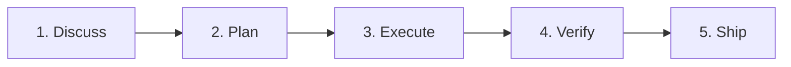

# Get Shit Done (GSD) Spec-Driven Framework

Based on the open-source **GSD Core** (`open-gsd/gsd-core` / `gsd-build/get-shit-done`) context-engineering methodology. It replaces unstructured "vibecoding" with a disciplined, deterministic 5-phase execution loop designed to eliminate context rot.

---

## The 5-Phase GSD Loop



### 1. Discuss Phase (`discuss`)

- **Goal**: Lock down requirements and eliminate ambiguity before writing code.
- Interactively confirm goals, edge cases, tech stack choices, and non-negotiables.
- Formulate acceptance criteria for the milestone.

### 2. Plan Phase (`plan`)

- **Goal**: Decompose milestone into small, atomic tasks that each fit in a clean context window.
- Store durable specifications in `.planning/`:
  - `.planning/PROJECT.md`: High-level architecture, boundaries, and technical decisions.
  - `.planning/ROADMAP.md`: Granular phases and milestones.
  - `.planning/STATE.md`: Active task status, current blockers, and session progress.
- Break large features into independent, verifiable subtasks (max 15-30 min per task).

### 3. Execute Phase (`execute`)

- **Goal**: Implement tasks atomically and deterministically.
- Follow the **Thin Screen Rule**: Keep screens under `src/app/` lightweight; modularize UI into `src/components/`, logic into `src/hooks/`, tokens into `src/constants/`.
- Maintain strict typing: zero `any`, explicit interfaces.
- Keep execution steps focused to avoid token bloat and context degradation.

### 4. Verify Phase (`verify`)

- **Goal**: Validate that the implementation satisfies specs before declaring success.
- **Automated Check**: Run `npm run typecheck`, `npm run format:check`, and `npm test`.
- **Visual & Browser Check**: Delegate to the built-in `browser` subagent to open Expo Web / DevTools and visually inspect UI, interactions, and console logs.
- Identify discrepancies and fix them immediately.

### 5. Ship Phase (`ship`)

- **Goal**: Cleanly package, commit, and record progress.
- Stage changes and run pre-commit hooks (`npx lint-staged` via Husky).
- Make atomic, descriptive git commits: `feat(...)`, `fix(...)`, `refactor(...)`.
- Update `.planning/STATE.md` to reflect completed deliverables.

---

## Durable Planning Directory Structure

Projects using GSD maintain state in `.planning/`:

```text
.planning/
├── PROJECT.md        # Architecture overview, tech stack, conventions
├── ROADMAP.md        # Milestone & feature breakdown
└── STATE.md          # Active state, completed tasks, next steps
```

## Quick Reference Rules

1. **Never skip Discuss and Plan**: Measure twice, cut once.
2. **Atomic Commits**: Every commit should represent one working, verified unit.
3. **Spec-Driven**: Read the spec from `.planning/`, verify against the spec, don't guess.
